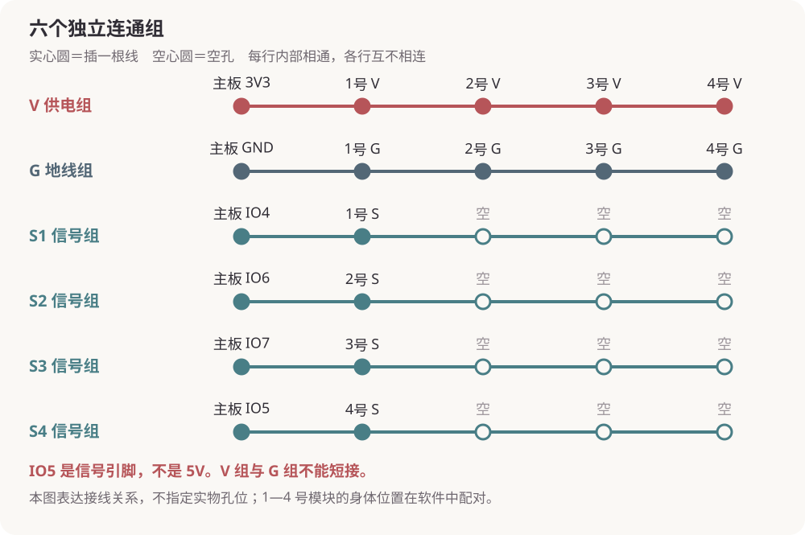

# youyou · USB 触碰陪伴小猫

把四片压力传感器接到 ESP32-S3 开发板，通过 USB 与 DeepSeek Harness 插件通信。插件提供悬浮猫咪、可视化设置和专属聊天，让 youyou 根据真实触碰作出回应。

当前范围是 Windows 上的 USB 桌面原型。人物设定为亲昵、软萌的黑色大耳猫；名字可修改，触碰部位可重新配对。Wi-Fi、语音和运动执行器不在本版范围内。

## 从这里开始

- **第一次购买或重新搭一套：**[采购、接线与首次使用指南](docs/GETTING-STARTED.md)，含四路接线图和逐步检查。
- **新开发板准备：**[首次固件准备附录](docs/FIRST-BOARD-SETUP.md)。已正常运行的板子不需要因日常使用再次刷写。
- **下载安装包：**[v0.3.6 发布页](https://github.com/lucisxu6-cpu/youyou/releases/tag/v0.3.6)。下载并解压 `youyou-usb-0.3.6.zip` 后，可双击 `docs/GETTING-STARTED.html` 离线阅读和打印。
- **查看日常操作：**[插件说明](plugin/README.md)。绑定、起名、校准、部位配对和去聊天都通过界面完成。

## 已验证的组合

| 项目 | 当前版本或规格 |
| --- | --- |
| 主板 | 微雪 ESP32-S3-DEV-KIT-N8R8-M，已焊排针，8 MB Flash／8 MB OPI PSRAM |
| 传感器 | 四套 KEYES 薄膜压力模块，V／G／S 三线，使用 3.3V 供电 |
| 物理信号输入 | GPIO4、GPIO6、GPIO7、GPIO5；身体位置由界面配对 |
| 固件 | 1.1.1，USB 协议 1 |
| 插件 | `@loveandrobot/dsh-pet-usb` 0.3.6 |
| 宿主 | Windows，DeepSeek Harness Desktop 0.2.1-rc.5 |



上图表示独立的电气连接组，不是面包板实物孔位图。接线前拔掉 USB；IO5 是信号脚，不是 5V 电源。完整步骤以采购与搭建指南为准。

## 工作流程

连接 USB → 识别兼容固件 → 绑定设备并起名 → 松手校准 → 配对四个部位 → 创建专属聊天 → 根据触碰回应。

插件始终关联一段专属聊天，切换其他聊天不改变关联。USB 断开后停止接收触碰，重新连接同一设备后恢复；部位、名字和会话关联保存在电脑上。运行期固件使用 RAM，不把触碰数据或用户设置写入 Flash。正常聊天、校准、配对和 USB 插拔均不刷固件。

短拍、连续拍、持续接触和双手重叠接触有不同的时序处理。压力片不能证明准确力度、真正拥抱或人的情绪。详细边界见 [触碰设计](docs/TOUCH-INTERACTIONS.md) 与 [生命周期设计](docs/PET-LIFECYCLE.md)。

## 开发材料索引

| 路径 | 内容 |
| --- | --- |
| `firmware/pet_usb/` | 当前 USB 固件 |
| `plugin/src/`、`plugin/client/`、`plugin/bridge/` | 插件逻辑、可视化界面、Windows 串口桥接 |
| `plugin/test/` | 自动测试及真实硬件检查工具 |
| `docs/` | 入门指南、接线图、协议、生命周期、触碰设计和审查报告 |
| `pet-firmware.ps1` | 受保护的编译和应用区升级入口 |
| `install-pet-plugin.ps1` | 测试、安装、配置备份和安装结果校验 |
| `package-release.ps1` | 生成离线指南及可复用发布包 |
| `arduino-cli.example.yaml` | 早期板卡／传感器验证脚本使用的本地配置模板 |
| 其他 `*-check.ps1` 及对应固件 | 早期硬件验证材料，保留作参考 |

本仓库只收录开发材料，不包含影片、配乐和创作素材。开发缓存、用户配置、密钥、运行日志和逐板 Flash 备份保留在本机，见 [仓库材料说明](docs/REPOSITORY.md)。

## 开发与验证

插件自动测试需要 Node.js 24：

```powershell
node --test plugin/test/*.test.mjs
```

该命令运行自动测试，不刷写开发板。真实 USB 检查需先退出 Harness 或停用插件，以释放串口；不要在日常使用中同时运行采集程序。

固件工具版本、安装目录、备份要求与初始化流程见 [技术附录](docs/FIRST-BOARD-SETUP.md)。现有板升级必须使用 `pet-firmware.ps1` 的保护和布局检查。发布包中的 `prebuilt/pet_usb.ino.bin` 只有应用镜像，不能写到 `0x0`。

最新审查覆盖 47 项自动测试、14 项真实 USB 协议检查及四路采样，详见 [最终审查报告](docs/FINAL-AUDIT-20261031.md)。该结果不等于已完成装入娃娃后的温升、机械耐久或长期漂移验收。

需要追溯修改时，查看 [开发历史](docs/DEVELOPMENT-HISTORY.md)；历史记录中的旧接线和旧版本不是当前搭建说明。
