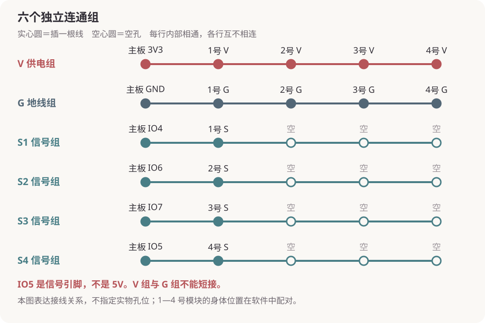

# youyou 首次采购与搭建指南

用一块开发板、四片压力模块和一根 USB 数据线，让小猫在 DeepSeek Harness 中根据触碰回应你。先在桌上接好并验证，再考虑装进娃娃。

本指南对应已验证的 **Windows＋DeepSeek Harness 0.2.1-rc.5＋插件 0.3.6＋固件 1.1.1**，更新于 2026 年 10 月 31 日。未来换主板型号或软件大版本时，需要重新核对兼容性。

**阅读顺序：买齐配件 → 准备新板 → 断电接线 → 安装插件 → 配对并聊天。** 已经正常使用的这一套，不需要重新接线或刷固件。

## 1 首次购买什么

下面的数量用于做一套四个感应部位的桌面原型。头部、背部、左爪、右爪各用一片，四片全部使用。

| 必需配件 | 数量 | 下单时认准什么 |
| --- | --- | --- |
| 微雪 ESP32-S3-DEV-KIT-N8R8-M | 1 块 | **已焊排针**版本，8 MB Flash＋8 MB PSRAM；官方 SKU 为 24243。不要仅搜索“ESP32”后随便选一块。 |
| KEYES 薄膜压力传感器模块 | 4 套 | 沿用已购的**不带胶壳版本**；每套包含感应片、已配套连接的电路板、三针连接线。模块输出标有 V／G／S。 |
| 170 孔迷你免焊面包板 | 1 个 | 用于把几根线接在一起。确认是标准五孔连通组结构。主板放在旁边，不需要硬插到迷你面包板上。 |
| 2.54 mm 杜邦跳线 | 1 包 | 本文统一接法需要 **公对公 12 根＋公对母 6 根**。20 cm 的混合装够桌面搭建，原先采购的 120 根混合装也可继续使用。 |
| USB 数据线 | 1 根 | 开发板端是 USB-C；电脑端按接口选 USB-A 或 USB-C。商品必须注明支持**数据传输**，不能只有充电功能。 |

主板型号、内存配置和 SKU 可对照[微雪官方产品说明](https://docs.waveshare.net/ESP32-S3-DEV-KIT-N8R8/)。购买时再确认“已焊排针”，避免收到需要自己焊接的版本。

传感器的[原采购商品链接](https://ic-item.jd.com/10146808184913.html)可作为复购线索；商品页当前库存、价格和选项需下单时核对。历史订单没有记录独立模块的完整料号，**不要把 KE3032、KE3057 等教学套件编号当成四片模块的购买型号**。确认买到原款模块和配套线；其他外形相似的压力模块可能需要改参数或接法。

可另备一套同款压力模块作为替换件。标签纸、绝缘胶带和理线带有助于整理线材；准备装娃娃时，再补可拆卸外壳或固定支架。

这套成品模块接法不另加裸 FSR 教程里的 10 kΩ 分压电阻，也不需要外接电池、USB 转串口板或面包板电源模块。语音和运动不在当前方案中，因此暂不采购麦克风、喇叭、舵机。

## 2 收到配件后先认清标识

**V、G、S 的含义：**

| 模块标识 | 含义 | 本项目接到哪里 |
| --- | --- | --- |
| V 或 VCC | 电源 | 开发板的 **3V3** |
| G 或 GND | 地线 | 开发板的 **GND／G** |
| S 或 Signal | 模拟信号 | 四个不同的 GPIO 输入，见后文 |

**3V3 表示 3.3V 电源；IO5 表示 GPIO5 信号引脚。IO5 不是 5V。** 不按排针“第几根”猜位置，要读主板旁边印的字。

杜邦线的“公头”是露出的金属针，“母头”是可以套住排针的孔。本指南按以下配件结构编写：模块原配线在连接开发板的这一端分成三个杜邦母头，开发板是已焊好的公排针。若实物插头不一样，先确认转换线，不强插。

原配线常见红色是 V、黑色是 G、黄色是 S，但延长线可能换过颜色。**最终按模块标识和完整走线确认，不凭颜色猜。** 本项目采用 3.3V 供电和模拟输出；KEYES 的[模块接线示例](https://www.keyesrobot.cn/projects/KE3032/zh-cn/latest/docs/Windows/MicroPython/15_%E5%AE%9E%E9%AA%8C%E5%8D%81%E4%BA%94%20%E8%96%84%E8%86%9C%E5%8E%8B%E5%8A%9B%E4%BC%A0%E6%84%9F%E5%99%A8.html)可用于核对 V／G／S 用途，示例中其他主板的 GP27 不能照搬到这里。

## 3 新主板先准备一次固件

“固件”就是开发板里面的程序。新买的板子通常带着厂商示例，还不会与宠物插件通讯。

| 你手上的板子 | 接下来做什么 |
| --- | --- |
| 已经在这套项目里正常使用 | 跳过固件准备，直接按需要接线或打开 Harness。 |
| 新买的同型号板子 | 先只连 USB，不接传感器；按[首次固件准备附录](FIRST-BOARD-SETUP.md)完成一次备份、核对和固件准备。 |
| 其他 ESP32 型号或存储规格 | 先确认兼容性，不能直接使用本项目的刷写地址和固件。 |

不熟悉固件准备时，可以把技术附录交给协助开发的人。**准备完成的标准是：固件为 1.1.1、USB 握手通过、识别到四路输入。** 电源灯亮或者有 COM 端口，还不代表宠物固件已准备好。

这一步只在新板首次准备或以后明确升级时进行。日常聊天、触碰、配对、校准和 USB 插拔均不刷固件。

## 4 断电后连接四片模块

### 第一步 给模块编号

拔掉开发板 USB，确认没有其他电源。给四套模块贴上 **1、2、3、4** 的标签，感应片和对应电路板一起编号。

编号只帮助接线，暂时不用决定哪片是头部。身体位置以后在设置里配对。

### 第二步 找到面包板的连通组

标准迷你面包板通常是一组五个孔内部相连，中央长沟两侧互不相连，相邻的组也互不相连。**一条金属连接片连接的五孔，才算同一组；不要把贯穿长沟的整排十孔当作同一组。** 参考[Adafruit 面包板说明](https://learn.adafruit.com/breadboards-for-beginners/breadboards)。

选六个互相独立的连通组，贴上 **V、G、S1、S2、S3、S4** 标签。170 孔迷你板通常没有长条电源轨，这里的“V 组／G 组”是你选出来的普通五孔组。

不同面包板的摆放方向和印字可能不同，因此本指南不指定 a1、b3 之类孔位。连通结构不确定时，先看该面包板说明，或在断电状态下用万用表通断档确认；没有把握就先不要通电。

### 第三步 按表把线接入六个组

| 独立连通组 | 放进同组的线 | 占用孔数 |
| --- | --- | ---: |
| V 组 | 主板 **3V3**，以及 1、2、3、4 号模块各自的 **V** | 5 |
| G 组 | 主板 **GND**，以及 1、2、3、4 号模块各自的 **G** | 5 |
| S1 组 | 主板 **IO4／GPIO4**，1 号模块 **S** | 2 |
| S2 组 | 主板 **IO6／GPIO6**，2 号模块 **S** | 2 |
| S3 组 | 主板 **IO7／GPIO7**，3 号模块 **S** | 2 |
| S4 组 | 主板 **IO5／GPIO5**，4 号模块 **S** | 2 |

图中每一条线是一组独立的连通关系，**不是实物孔位排列图**。V 与 G 不能相连，四个 S 也不能相互接到一起。

### 第四步 对照线材怎么插

1. 每个模块的原配线有 V、G、S 三个母头。每个母头各接一根公对公跳线，另一头插入表中对应面包板组。四套合计 **12 根公对公**。
2. 开发板的 3V3、GND、IO4、IO6、IO7、IO5 各接一根公对母线：母头套住开发板排针，公头插入对应面包板组。合计 **6 根公对母**。
3. 让模块和主板平放在绝缘桌面上，金属针不要碰到其他针脚或金属杂物。

如果你现有的 S 线已经直接接到正确 GPIO，不必为了符合示意图重新改线；同一对端点直接连接和经独立面包板组连接，在这里是同一个信号连接关系。

### 第五步 通电前检查

- 四个 V 最终都连到 **3V3**，没有接到 5V。
- 四个 G 最终都连到 **GND**，V 组与 G 组彼此独立。
- 四个 S 分别连到 **IO4、IO6、IO7、IO5**，没有共用同一信号组。
- 四片感应区都已松开，没有被书本、工具或线材压住。

核对完再插入 USB。以后要挪动杜邦线，也先拔掉 USB。

## 5 安装插件并完成第一次设置

### 先准备电脑

使用 Windows，安装已验证兼容的 DeepSeek Harness 版本，并先确认普通文字聊天可用。当前模型调用需要电脑联网；开发板仍只走 USB，不需要给它配置 Wi-Fi。

同一个 USB-C 接口可能让 Windows 出现两个 COM 端口，这是板载 USB Hub 的正常表现。需要辨认时，在设备管理器查看名称含 **USB-Enhanced-SERIAL CH343** 的那个；不要记死“COM4”。详见[微雪端口说明](https://docs.waveshare.net/ESP32-S3-DEV-KIT-N8R8/FAQ/)。缺少驱动时从微雪资料页指向的官方驱动入口安装。

### 再安装宠物插件

1. 把完整交付包解压到准备长期保留的文件夹。安装前先解压，不在压缩包内部操作。
2. 打开 Harness 左侧的 **插件**，在 **添加插件** 旁的下拉菜单选择 **安装第三方插件**。
3. 在 **包名或地址** 中填写解压后 **plugin 文件夹的完整路径**，例如 `D:\youyou-usb\plugin`，按提示安装并启用。这是文件夹路径，不是聊天指令。当前界面明确支持本地目录。
4. 如果未出现猫咪图标，完整退出 Harness（包括托盘）后重新打开。安装本地目录后保留该目录；不要随手删除或移动。

熟悉开发的人也可使用交付包的 `install-pet-plugin.ps1`，它会先跑测试、备份 Harness 配置，再校验安装文件是否与源码一致；该方式需要 Node 24 和 Harness 自带工具。预打包插件在 `prebuilt` 中，源码安装目录是 `plugin`。

### 最后点击陪伴设置

| 顺序 | 你要做什么 | 完成后应看到什么 |
| --- | --- | --- |
| 1 | 连接 USB，打开猫咪菜单 → 陪伴设置 | 找到兼容设备，可绑定 |
| 2 | 点“绑定这只小猫”，填写名字并保存 | 显示你起的名字 |
| 3 | 松开四片，点“开始校准”，等待约 3 秒 | 可以开始部位配对 |
| 4 | 点“开始配对”，按提示选择头部、背部、左爪、右爪 | 一次只显示当前一步 |
| 5 | 每次只按对应的一片；显示“记住啦，请松开”后松手 | 自动进入下一步 |
| 6 | 四步完成后点“保存位置” | 触碰设置显示“已设置” |
| 7 | 点“开始陪伴” | 建立专属聊天，可以对话 |

感应片还在桌上时，按提示选一片作为该部位即可；之后把这片装到对应位置。左右爪按**猫咪自己的左右**命名。若后来换了位置，点“重新配对”，不需要改代码或刷固件。

当前每台电脑的一个宠物档案只绑定一块板和一段聊天。聊天改名、切换到其他聊天，都不会改变绑定。

## 6 先做一轮简短验收

1. 打一句话，确认小猫能正常回复。
2. 逐片按下、松开，确认四个部位都能在设置里出现对应反馈。配对时不触发聊天，保存后才恢复触碰回应。
3. 等上一条回复完成，按住一片约 2 秒后松开，确认原来的陪伴聊天收到相关回应。
4. 正常使用状态下拔掉 USB，等约 5 秒再插回，确认自动重新连接，名字、部位和原聊天都还在。

不要求每按一下都单独说一句：连续触碰会合并，回应有间隔，模型忙时过旧的触碰会丢弃。这里测的是接触与时间变化，不能把一次压力读数当作轻抚、拥抱或准确力度。

## 7 以后日常使用和再做一套

| 情况 | 做法 |
| --- | --- |
| 每天使用 | 打开 Harness，插 USB，从猫咪菜单去聊天。一般无需重复校准或配对。 |
| 暂时不想让触碰触发回复 | 点“安静陪一会儿”。文字聊天仍然可用；需要时再恢复。 |
| 正常拔插 USB | 可直接拔插，不需要先暂停；不要在明确进行固件刷写时拔线。 |
| 更换线材、接入新感应片 | 先拔 USB，再接线；换传感器后重新校准，并按需重新配对。 |
| 只交换感应片身体位置 | 点“重新配对”；名字和原聊天保留。 |
| 同一电脑换新板 | 先为新板准备固件；旧板拔掉，在设备详情解除原设备绑定，再绑定新板、校准和配对。原名字与聊天保留。 |
| 另一台电脑再做一套 | 重用本交付包和接线方案，在新电脑重新绑定、校准和配对。旧电脑的绑定状态不直接套用到新设备上。 |
| 同时连接多块同类板 | 当前插件不自动选择目标，也不支持同时养多只；先只连要使用的一块。 |

插件与固件可以复用；每块板的设备身份由自身决定，每台电脑上的名字、校准、部位和聊天需要按实际使用建立。固件不保存这些用户设置。

## 8 装进娃娃之前

桌面验证通过后，再确定头部、背部、两只爪子的安装位置。给感应片留合适支撑，避免棉花在无人触碰时持续压住它；不要折出死弯、用尖锐物戳压或把拉力传到感应片根部。

开发板、金属排针和接头要有绝缘、防拉扯及可拆卸固定；USB 线留出口，主板周围留散热空间。面包板与松插的杜邦线适合桌面验证，不能直接视为经长期耐久验证的成品线束。

安装后先松手重新校准，再逐一验证四个部位。若校准失败，先检查棉花预压、支撑和线路，不通过加大按压力度或强行放宽校准来掩盖问题。当前尚未完成装配后的温升与耐久验收。

## 9 遇到问题先查哪里

| 现象 | 优先检查 |
| --- | --- |
| 主板亮灯，但电脑或插件找不到 | 数据线是否支持传输；是否出现 CH343；是否已经准备宠物固件。不要先反复刷写。 |
| 看见两个 COM 端口 | 正常；开发调试选择 CH343，插件自动找支持的接口。 |
| 提示串口被占用 | 关闭其他串口监视器、采集程序；同一端口一次只能由一个程序使用。 |
| 校准一直不通过 | 全部松手；检查裸片是否被压住、接线是否松动。重新插线前先断电。 |
| 配对有感应，但不前进 | 只按一片并稍停；确认不是已经选过的片；看到成功后要完全松开。 |
| 按头部却显示其他部位 | 重新配对位置，不要凭感觉交换电源线。 |
| 感应有反馈，但没有聊天回应 | 是否保存四个位置、开启触碰回应；原聊天是否归档或正在回答；普通聊天和网络是否正常。 |
| 插拔后位置或名字似乎变了 | 先确认还是同一电脑、同一 Harness 用户环境、同一块板；不要立即解绑或删配置。 |

进一步的技术约束见 [USB 协议](USB-PROTOCOL.md)，状态处理见 [生命周期说明](PET-LIFECYCLE.md)，验证范围见 [最终审查报告](FINAL-AUDIT-20261031.md)。
